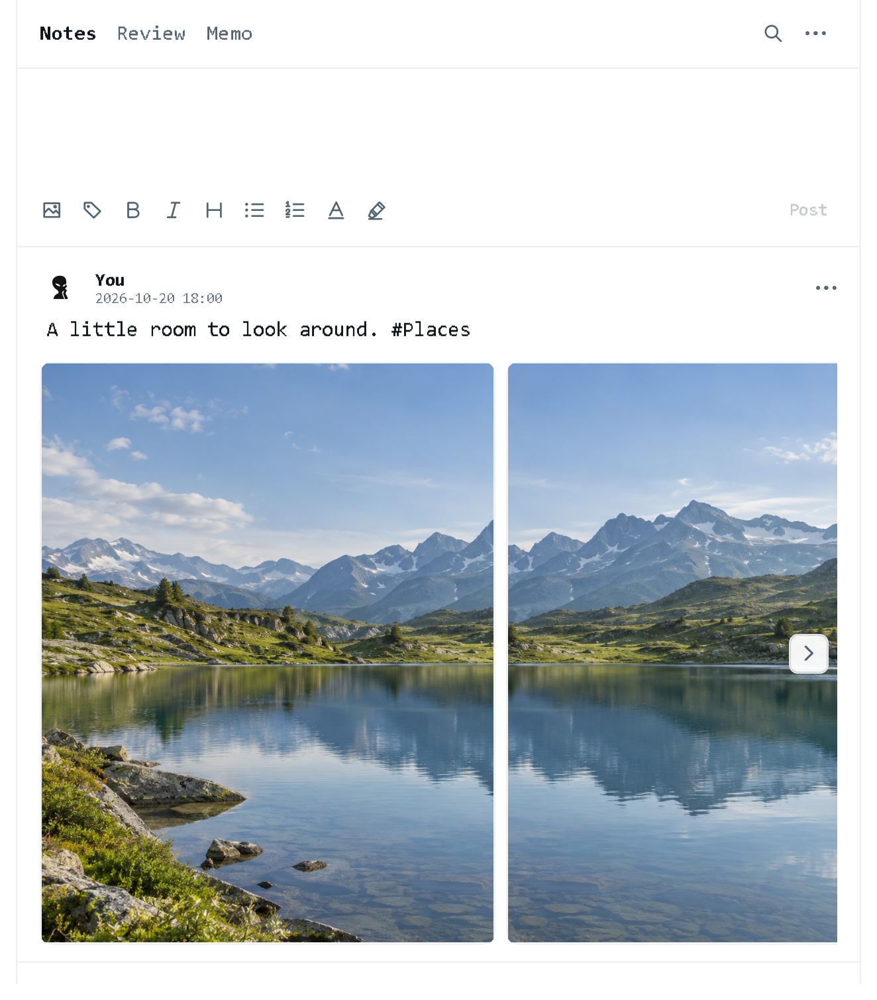
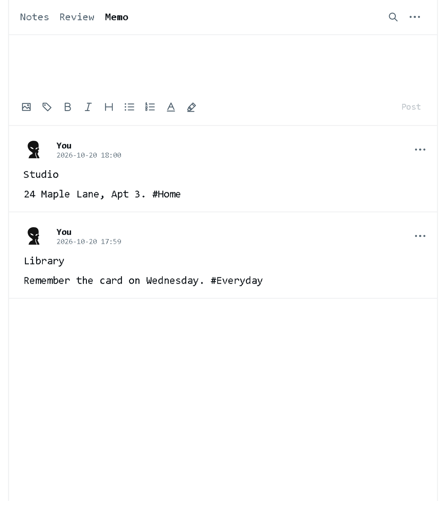

<p align="center"></p>

# ClearNote

A quiet, offline notebook for Windows. Capture ideas, keep everyday information close, and return to learning notes through spaced review.

## Features

- **Notes** — write above a scrolling feed, then post with one click or Ctrl+Enter.
- **Memo** — a separate feed for addresses and everyday information, with its own draft and search.
- **Review** — revisit learning notes by tag; a sufficiently visible note records one review per round. Memo stays outside review.
- **Writing** — Markdown headings, emphasis, quotes and lists, with selected text colors and highlights. Code fences remain plain text.
- **Images** — attach up to four pictures and browse them horizontally at their natural proportions. Imported files are copied; originals remain unchanged.
- **Your identity** — choose a local username and avatar. No account is required.
- **A comfortable window** — choose Wider or Narrower from the menu. ClearNote remembers the width; height remains resizable.

The interface is English, with a white background and dark text. Latin text uses Consolas; Chinese text uses FangSong.

## Screenshots

| Notes | Memo |
| --- | --- |
|  |  |

These images use demonstration data rendered with the application's own controls.

## Run

[Download the latest Windows release](https://github.com/ArdeaNew/ClearNote/releases/latest).

Use Windows x64 with the **Microsoft .NET 10 Desktop Runtime** installed. Extract the portable folder and open `ClearNote.exe` from a writable location.

A new notebook starts with two welcome posts. They are ordinary editable notes; deleting them also removes an exclusively owned picture. Deleted welcome posts do not return.

## Everyday controls

- Post: Ctrl+Enter. Save drafts and open edits: Ctrl+S. Refresh: F5.
- Double-click a post to edit. Save commits changes; Cancel or Escape restores the saved post.
- Type `#tag` to label a note. Tab or Enter accepts a tag suggestion.
- At the start of a paragraph, type a positive number followed by a space to begin an ordered list. Enter continues it; Enter on an empty item exits.
- Use Search to filter the active feed. Review opens its tag menu without changing the feed until a choice is made.
- Browse pictures with the gallery arrows, Left/Right keys, or Shift+wheel. The ordinary mouse wheel scrolls the feed.

PNG, JPEG, BMP, GIF and TIFF are supported; other formats depend on installed Windows codecs. Each source picture must fit the import limits of 20 MiB, 40 megapixels and 16,000 pixels per side. Large PNG conversions may be reduced proportionally in the imported copy.

## Your files

All active usage data stays beside the executable in **Log**:

| Location | Contents |
| --- | --- |
| `Log/Data` | Both feeds, review history, separate drafts, recovery saves, images and the optional profile |
| `Log/Backups` | Requested backups and a safety snapshot before Restore |
| `Log/window.json` | Window width, saved after an adjustment |
| `Log/Diagnostics` | Bounded error logs; these may contain affected file paths |

Keep the entire **Log** folder when moving or updating ClearNote. Backups include both feeds, their valid drafts and images. Restore validates an archive before replacing the library and preserves the previous data folder.

Deleting a post clears its active and recovery records. A locally copied picture is removed when no other post, profile or recoverable draft uses it. Original source files and manually exported archives remain independent. Closing the app or deleting a post does not create an automatic archive.

## Build

Use Windows, PowerShell and the .NET 10 SDK:

```powershell
./src/build.ps1
```

This builds the solution, runs Core and WPF component checks with synthetic data, and publishes the portable executable to `app`. The app has no external package dependencies. The Windows workflow performs the same build and checks and prepares a portable artifact.

The maintained projects are `Folio.Core`, `Folio.App`, `Folio.Tests` and `Folio.UiTests`. The internal Folio names remain for compatibility. App depends on Core; Core has no WPF dependency.

See [architecture](docs/ARCHITECTURE.md), [contributing](CONTRIBUTING.md), and [verification](docs/VERIFICATION.md) for development details.

## License

[MIT](LICENSE).
