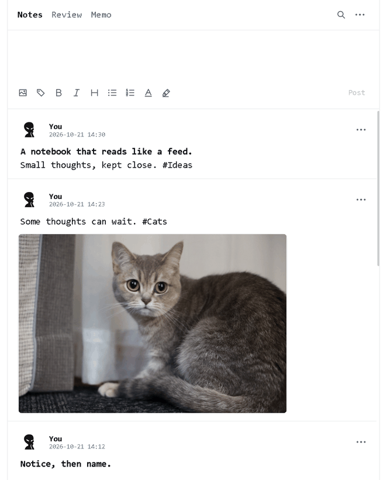
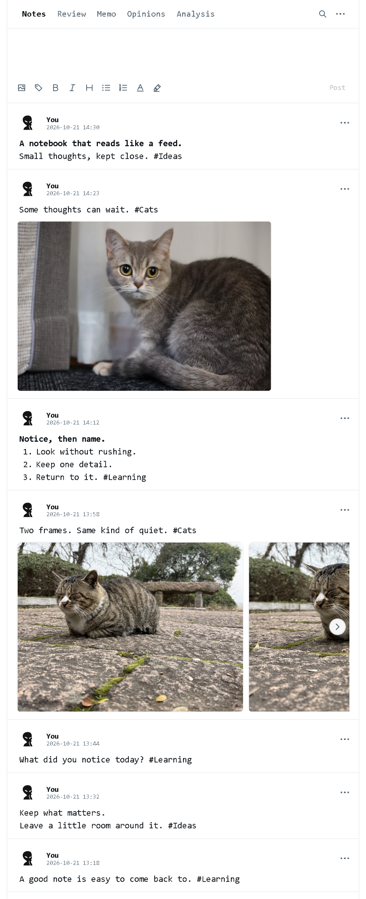

# ClearNote

**An offline notebook for Windows, built around a continuous feed.**

[Download ClearNote.exe](https://github.com/ArdeaNew/ClearNote/releases/latest/download/ClearNote.exe) · [Quick guide](docs/USAGE.md)

Write at the top. Scroll through your ideas. Double-click a post to edit it where it belongs.

- **Notes** — thoughts, photographs and things worth learning.
- **Review** — spaced review of Notes, filtered by tag.
- **Memo** — a separate stream for everyday reference.
- **Opinions** — other voices, excerpts and sentences worth keeping.
- **Analysis** — observations, data and economic thinking.

## Room for the things you notice

A white page, fine dividers and quiet controls. Text and pictures share the same uninterrupted reading column.

Markdown shortcuts, color and highlights keep writing flexible. Add up to four pictures; their originals stay unchanged. Your name and avatar make the notebook yours, without an account.

Install and local files

Download `ClearNote.exe` into a writable folder and open it. **Windows x64. No installation required.** The runtime is included. Current releases are [unsigned](docs/CODE_SIGNING.md).

Your notes, pictures, drafts and preferences stay beside the executable in **Log**. Keep that folder when moving or updating the app. Back up or restore your library from the menu.

[MIT license](LICENSE).
