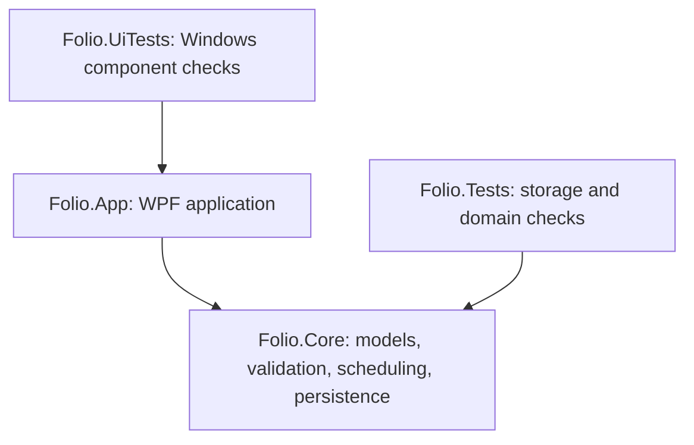

# ClearNote architecture

ClearNote is a local Windows desktop application with one portable data directory. Its structure favors direct calls and a small dependency graph over additional frameworks.



There are no external package references. Core targets `net10.0`; App and its UI checks target `net10.0-windows`. All projects enable nullable references and deterministic builds through `Directory.Build.props`. The legacy Folio project and namespace names remain internal compatibility details; the executable and product are ClearNote.

## Responsibilities

| Area | Responsibility | Kept outside it |
| --- | --- | --- |
| `Folio.Core/Models.cs`, `NoteText`, `NoteColors`, `NoteTags`, `MarkdownText` | Validated note structures, independent copies, derived tags and bounded shorthand parsing | WPF, clipboard and rendered layout |
| `Folio.Core/ReviewScheduler.cs` | Recall estimates, memory updates and weighted Notes selection | Viewport visibility and session boundaries |
| `Folio.Core/LibraryStore.cs` | Library loading, atomic commits, image ownership paths, validated backup/restore and shared storage primitives | Dialogs, bitmap decoding and UI state |
| `LibraryStore.Drafts.cs` | Independent collection drafts, external-change checks and recovery versions | Editor controls and timers |
| `LibraryStore.Profiles.cs` | Profile validation, isolated recovery, atomic profile saves and profile conflict tracking | Avatar decoding and profile dialogs |
| `LibraryStore.Deletion.cs` | Deletion intent, recovery completion and removal of unshared managed images | User-selected source files and manual archives |
| `Folio.Core/NoteImages.cs`, `ArchiveLimits.cs` | Encoded-image and archive validation, size/path/integrity limits | Optional Windows image codecs |
| `Folio.Core/PortableStorage.cs` | Copy-and-verify migration of older adjacent data into `Log` | Desktop window behavior |
| `Folio.App/App.xaml.cs` | Startup, English native dialogs, path-based instance locks, library opening and recovery | Scheduling equations |
| `Folio.App/MainWindow*` | Shared-feed composition, draft lifecycle, collection navigation, Review and user commands | JSON serialization and asset deletion rules |
| `MainWindow.Width`, `WindowWidthPreferences` | Work-area fitting, fixed-step width actions and atomic local window preferences | Notebook formats and portable library archives |
| `WindowSystemMenu` | Native-frame menu policy, resize availability and window-lifetime hook cleanup | Feed navigation, drafts and persistent data |
| `Folio.App/Controls/NoteEditor.cs` | Native continuous text editing and structured capture, Markdown entry, lists, text formatting and undo | Persistent file writes |
| `FeedView`, `FeedNoteCard` | Batched feed rendering, visible-note events, inline editing and post presentation | Review-memory equations |
| `AttachmentPanel`, `ImageAttachments` | Same-height galleries, guarded asynchronous imports, independent PNG/JPEG copies and bounded frozen preview caching | Library recovery and backup policy |
| `AppIcons`, `AppTypography`, `ProfileDialog`, `TextColorMenu`, `TagSuggestions` | Reusable presentation and local interaction | Storage formats |

`LibraryStore` is a partial class because these operations share one lock, one serialization configuration, validation primitives and a coherent transaction boundary. Its partial files group responsibilities without creating independently writable repositories for the same files. Profile state reset is shared between initial load and restore.

## Data and identity

Normal portable startup uses:

```text
ClearNote.exe
Log/
  Data/
    library.json
    library.previous.json
    assets/
    draft.json                                (when saved)
    draft.previous.json                       (draft recovery)
    memo-draft.json                            (when saved)
    memo-draft.previous.json                   (Memo draft recovery)
    opinions-draft.json                        (when saved)
    opinions-draft.previous.json               (Opinions draft recovery)
    economic-analysis-draft.json               (when saved)
    economic-analysis-draft.previous.json      (Economic Analysis draft recovery)
    profile.json                              (optional)
    delete.pending.json                       (only during interrupted deletion)
  Backups/                                    (explicit exports)
  Diagnostics/                                (errors only)
  window.json                                 (window preference, when adjusted)
```

`window.json` contains presentation settings rather than review or note content and is excluded from library archives. Restoring a library preserves the former Data directory beside the new one. The optional `--data` argument selects a separate library directory for development and recovery work. Never use real notebook data as a fixture.

`CardDocument.Collection` identifies Notes, Memo, Opinions or Economic Analysis. Schema 6 persists all four collections; the reader accepts schemas 1–6 and preserves earlier Notes/Memo identities. An absent collection defaults to Notes. Collections share a library snapshot, asset directory and local profile. Fixed, separate draft filenames preserve each composer's in-progress text and attachments. Core prevents an existing note from changing collection through `Upsert`. Scheduler selection and direct browse recording use Notes only.

The local identity is shared, rather than copied into every post. Changing a name or avatar updates the displayed authors while preserving note content, review history and editing buffers. Default identity and first-run welcome creation belong to App. Welcome posts are ordinary Core documents; a saved empty library is not new and never repopulates deleted posts.

## Write and recovery boundaries

`Cards`, note content and profile reads return independent copies. UI edits become persistent through explicit store methods. Ordinary commits validate a complete candidate, compare the known library hash, flush a new file, then atomically replace the primary while retaining the preceding complete save. Recovery tries the previous complete save and blocks unsafe writes if both copies are invalid.

Drafts and profile have separate change tracking. A damaged draft or profile must not disable healthy saved notes, and saving a note must not silently overwrite external draft or profile edits. Backup validates the combined state and rechecks all inspected files before publishing an archive. Restore validates and stages the complete archive before moving an existing healthy library.

Images are imported before notes or drafts refer to them. App validates and fully decodes each selected file. Normal-orientation PNG/JPEG assets retain their encoded bytes only when they satisfy Core's strict portable-container validation. A Windows-readable source with trailing data, incomplete non-pixel framing or incompatible metadata is re-encoded from decoded pixels into a strict PNG; other formats and rotated images use the same normalization path. Core validation is not relaxed. Core assigns an immutable SHA256 filename and ensures the reference resolves within the asset directory. Equal bytes may share one file.

Picker and paste-data capture remain on the UI thread. Clipboard bitmap capture detaches actual pixels while the provider and any lazy stream remain available; the caller's surface is neither frozen nor modified. Decoding encoded files, conversion, durable asset writes and thumbnail preparation run on a worker. A damaged PNG clipboard representation can fall back to a separately captured Bitmap before storing anything. Storage failures never trigger an alternate decode or a second asset write. The attachment panel owns its pending operation; publishing, collection replacement, deletion and restore wait for it, and a requested close finishes after the completed attachment joins its draft. Detached, frozen previews use a bounded memory cache; accessing an asset still validates its file before showing a cached preview.

ImageFailureContext annotates original exceptions at source-read, decode, clipboard-capture and storage boundaries without wrapping or changing their types. Messages and bounded diagnostics use that stage plus native error codes. An unavailable stored asset is distinguished from an oversized or empty file; preview failures keep their references and render a recoverable placeholder.

Explicit deletion first plans the removed note's managed assets and retains any asset referenced by another post, the profile or any collection's current or recoverable previous draft. A small durable intent lets restart finish interrupted cleanup. Both library snapshots are sanitized so recovery cannot resurrect deleted text. Only then are unused local pictures removed. Source files chosen for import and manually exported backup archives remain independent.

The UI saves a dirty composer before deleting a note so ownership checks can see unsent image references. It saves pending edits and the departing draft before changing feeds. A failed save leaves the active feed and buffers available for retry. Review visibility events are counted once per round by App, then persisted through the Core scheduler.

## Interaction events

Events describe completed UI changes; synchronous callbacks remain responsible for accepting or rejecting persistence. A note does not announce a successful save until its durable callback succeeds and its editor returns to read-only presentation. FeedView forwards completed save/deletion events so the window can update derived tags and active filtering in place, without rebuilding unrelated editors or persisting their unfinished changes. Failed saves and cancelled edits do not emit content-change events.

Import-state events protect command availability while a control owns background image work. The owning control completes or reports failure before its parent resumes navigation or a deferred close. Profile picture decoding uses the same background importer; the dialog owns its pending selection and preserves its previous durable profile until Save succeeds.

WindowSystemMenu follows SourceInitialized, StateChanged and Closed, and refreshes before its native popup opens. It exposes only commands applicable to the current state, keeps native Close on the WPF Closing path, and removes its hook and event subscriptions at disposal. Native menu policy does not depend on notebook state. These local event relationships do not require a global event bus, service locator or Core dependency on WPF.

## Compatibility and deliberate limits

`NoteBlock`, page-size constants, legacy image handling and older archive readers support existing libraries and backups. The internal Folio identifiers and path-based instance-lock prefix are also retained for compatibility.

The current interface has no network services, account, synchronization provider, HTML execution or embedded web renderer. Markdown shorthand becomes bounded structured text; code-looking text remains literal. New persistence and media changes should preserve that narrow surface and avoid introducing packages for operations already covered by the platform.

## Verification

The Core harness covers old schemas, text and tag bounds, review behavior, independent copies, all collections, atomic storage, conflicts, corruption, image ownership, interruption, backup/restore and portable migration. The Windows UI harness covers editing behavior, layout, text formatting, galleries and codecs, feed switching, review visibility, profile identity, error handling, welcome lifecycle and width preference persistence.

Both are ordinary executable programs with nonzero failure exit codes. Run the exact commands in [CONTRIBUTING.md](../CONTRIBUTING.md); `dotnet test` alone does not execute these harnesses. Every run creates an isolated synthetic directory. UI previews render actual application controls offscreen and do not establish native desktop or monitor behavior. [VERIFICATION.md](VERIFICATION.md) records the latest checked release and its practical limits. [ALGORITHM.md](../src/Folio.Core/ALGORITHM.md) details saved formats and scheduling.

The Windows CI workflow checks out source with read-only repository permissions and no persisted Git credentials, installs .NET 10, builds, runs both harnesses and publishes a self-contained Windows x64 executable. The compressed single-file bundle includes the .NET/WPF runtime and native libraries. Artifact inputs are individually listed; runtime data, synthetic libraries and diagnostics are not uploaded. CI creates no GitHub Release and never modifies an installed notebook.
