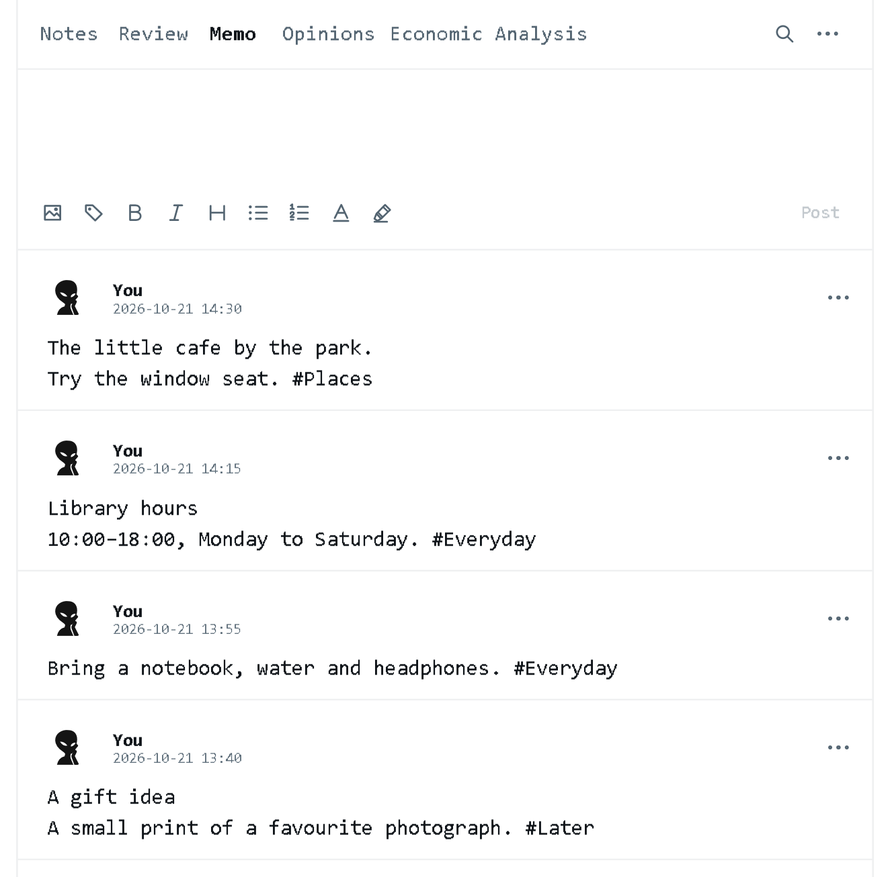
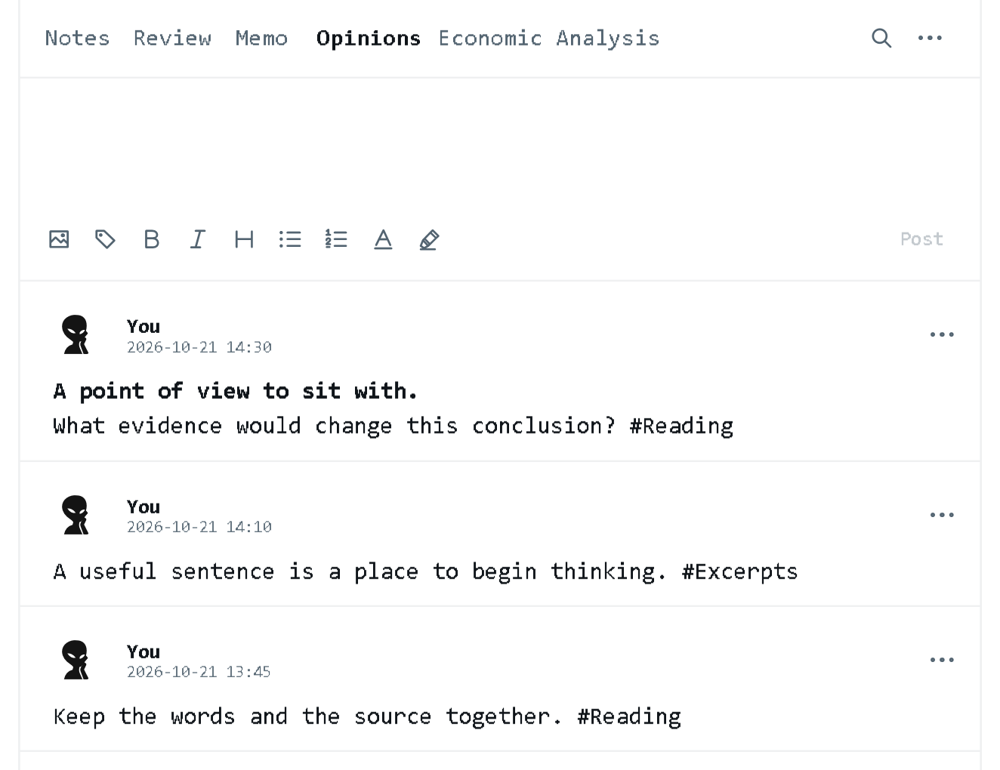
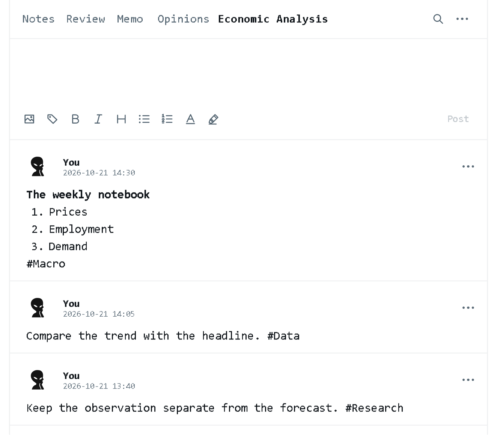
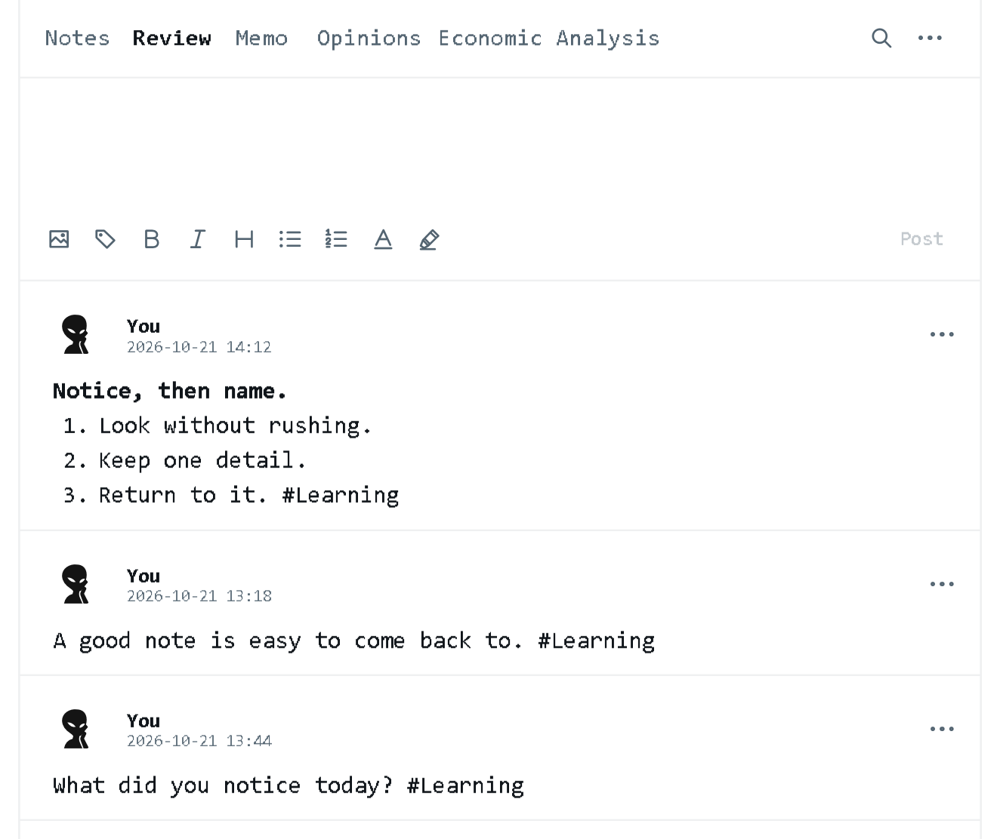

# A quick look at ClearNote

[Download ClearNote.exe](https://github.com/ArdeaNew/ClearNote/releases/latest/download/ClearNote.exe) · [Back to ClearNote](../README.md)

## Write. Post. Keep scrolling.

Write above the feed and click **Post** or press **Ctrl+Enter**. Double-click any post to edit in place. Text, lists and pictures stay together in one scrolling notebook.

## Keep everyday details in Memo

A separate feed and draft for addresses, plans and everyday reference. Memo stays outside Review.

## Keep other voices in Opinions

Collect viewpoints and excerpts, with their sources alongside them.

## Make room for Economic Analysis

Keep economic observations, data and research in their own feed.

## Return to what you want to remember

Type **#tag** as you write. Open **Review** and choose a tag. Scrolling a note into view records one review per round.

| Action | Control |
| --- | --- |
| Post | Ctrl+Enter |
| Save drafts and edits | Ctrl+S |
| New paragraph / line break | Enter / Shift+Enter |
| Start an ordered list | Type `1. ` |
| Search this feed | Magnifier |
| Browse pictures | Gallery arrows or Shift+wheel |
| Change name or avatar | Right-click an avatar |

Each feed saves its own draft automatically. Review uses Notes only. All files stay in **Log**, beside the app.
